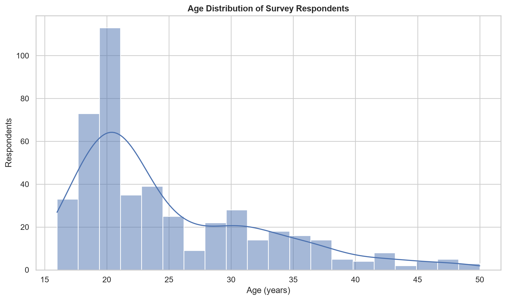
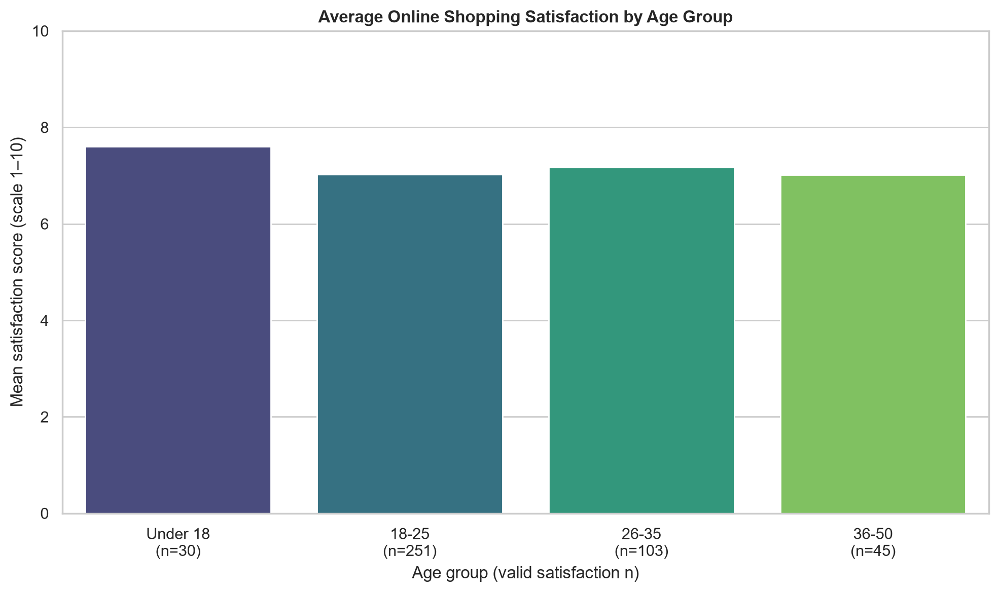
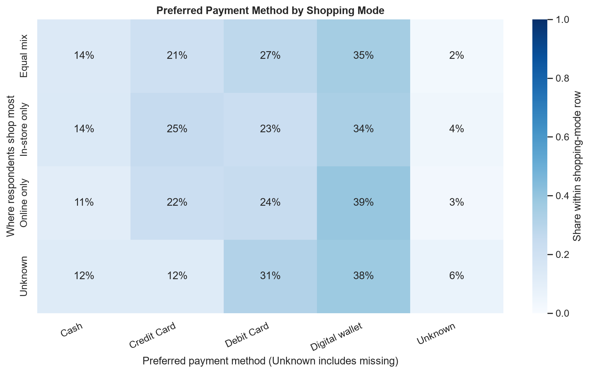
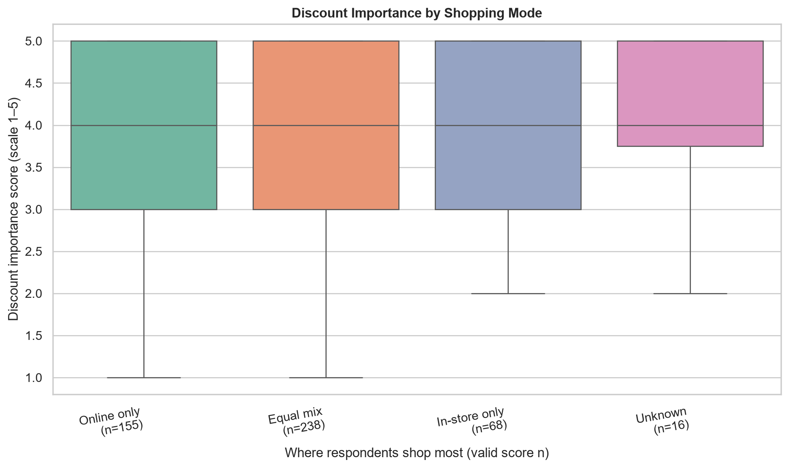
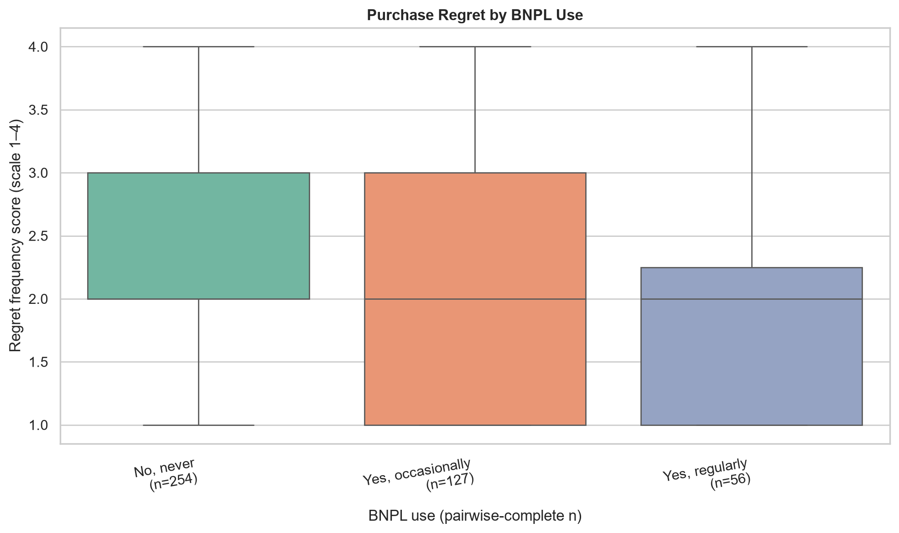
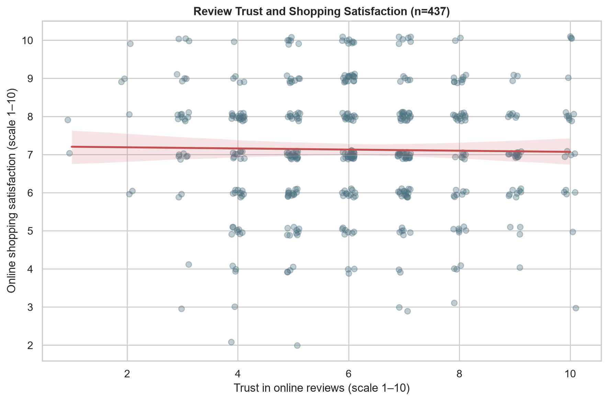

# E-commerce Customer Behavior Analysis

Exploratory analysis of a 500-response consumer shopping behavior survey. The notebook summarizes respondent demographics and shopping preferences, then examines online shopping satisfaction, review trust, purchase regret, and buy-now-pay-later (BNPL) use.

## Project files

- `notebooks/EcommerceEDA.ipynb` — documented analysis, statistical comparisons, and six charts.
- `data/raw/consumer_shopping_behavior_survey.csv` — supplied source dataset (500 rows, 30 columns).
- `archive/EcommerceEDA_backup.ipynb` — preserved, unmodified backup; excluded from version control by `.gitignore`.

## Run the notebook

Tested with Python 3.14.7. From this project directory:

```powershell
py -3.14 -m venv .venv
.\.venv\Scripts\Activate.ps1
python -m pip install -r requirements.txt
jupyter notebook notebooks/EcommerceEDA.ipynb
```

Run this command from the project root. The notebook locates the CSV under `data/raw/`, and also supports a kernel started in `notebooks/`.

## Dataset and data handling

### Dataset Source and Attribution

The original dataset is **Consumer Shopping Behavior and Buying Survey Dataset**, uploaded by **Harpartap Singh (@harpartapsingh13)** on Kaggle: [dataset page](https://www.kaggle.com/datasets/harpartapsingh13/consumer-shopping-behavior-and-buying-survey-dataset).

The dataset is the original source material. The notebook, visualizations, statistical summaries, and any project-specific data handling or modifications in this repository are my independent analysis; they are not part of the original dataset and should not be attributed to its creator. The local CSV is excluded from Git while its Kaggle licence is unverified. No licence or permission to redistribute the dataset is asserted here.

The supplied CSV contains 500 responses and 30 fields. `Response_ID` is unique in the file. Age is stored as text because 22 entries are blank and eight nonblank entries are not numeric; these are treated as missing for age calculations. The timestamp is parsed in day/month/year order. Missing answers in six selected categorical fields are labeled `Unknown`; other missing values remain missing and are excluded only from calculations that require them.

Thirty records (6.0%) have no response across the six final survey fields used for satisfaction, trust, regret, and shopping reasons/mode. They are retained in the data. This pattern may indicate survey attrition, but the dataset alone does not establish the reason.

The source, sampling method, survey question wording, and representativeness were not supplied. Results describe these responses and should not be generalized without that context.

## Analysis and statistical interpretation

The notebook includes respondent and age-group summaries, online and in-store preferences, country and occupation comparisons, payment-method and spending-category shares, review-trust correlations, and regret-score comparisons by BNPL use. Each grouped table distinguishes total respondents from valid observations for the measure.

In the validated analysis, review trust and satisfaction have near-zero correlations (Pearson *r* = −0.0179, *p* = 0.7092; Spearman *r* = −0.0216, *p* = 0.6524; 437 complete pairs). The Kruskal–Wallis comparison of regret scores by BNPL group is nonsignificant (*H* = 1.826, *p* = 0.4013; group sizes 254, 127, and 56). These results do not provide statistically significant evidence of an association or group difference in this sample; they do not prove that no population relationship exists and do not establish causation.

## Visualizations

The six charts below are exported from the analysis notebook.

| Respondent age distribution | Satisfaction by age group |
| --- | --- |
|  |  |
| Shows the distribution of numeric ages after blank and nonnumeric entries are excluded. | Compares mean satisfaction scores across age groups; labels show valid response counts. |

| Preferred payment method by shopping mode | Discount importance by shopping mode |
| --- | --- |
|  |  |
| Shows each payment method's share within respondents' preferred shopping mode. | Boxplots compare discount importance scores across online, mixed, and in-store shoppers; labels show valid score counts. |

| Purchase regret by BNPL use | Review trust and shopping satisfaction |
| --- | --- |
|  |  |
| Boxplots compare regret frequency across BNPL use groups; labels show pairwise-complete counts. | Jittered points show paired trust and satisfaction scores, with a fitted linear trend line. |

## Project structure

```text
Ecommerce Customer Behavior Analysis/
├── README.md
├── requirements.txt
├── .gitignore
├── images/
│   ├── respondent_age_distribution.png
│   ├── satisfaction_by_age_group.png
│   ├── payment_method_by_shopping_mode.png
│   ├── discount_importance_by_shopping_mode.png
│   ├── purchase_regret_by_bnpl_use.png
│   └── review_trust_vs_satisfaction.png
├── data/
│   └── raw/
│       └── consumer_shopping_behavior_survey.csv
├── notebooks/
│   └── EcommerceEDA.ipynb
└── archive/
    └── EcommerceEDA_backup.ipynb
```
